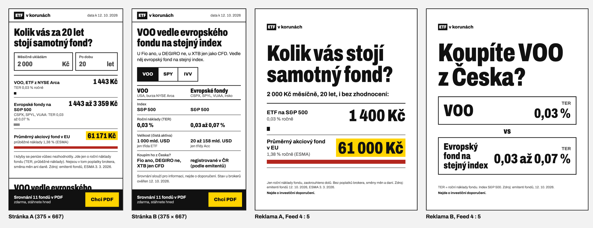

# ETF v korunách

Landing page pro českého drobného investora, který přijde z reklamy na Instagramu: kalkulačka nákladů fondu a srovnání ETF z NYSE Arca s evropskými fondy na stejný index. Za e-mail dostane PDF srovnání 11 fondů.

- **Stránka:** https://etf-landing-sigma.vercel.app/ (reklama A je výchozí, verze B: [`?utm_content=b_srovnani`](https://etf-landing-sigma.vercel.app/?utm_content=b_srovnani))
- **Reklamy:** [ads/README.md](ads/README.md) (texty, odkazy s UTM, vizuály pro Feed a Stories)
- **Odměna:** [srovnani-etf.pdf](public/srovnani-etf.pdf) (6 stran ve formátu telefonu)

## Dala by se zítra pustit reklama?

**Ano, pokud se dosadí provozovatel, přepne hosting a projdou pravidla Meta pro finanční reklamy (asi 2 až 3 h).** Stránka, měření a reklamy jsou hotové. Povinný souhlas doporučuji před ostrým spuštěním nechat posoudit právníkem.

Celá cesta funguje a je změřená: reklama → první obrazovka podle reklamy → formulář → kontakt v databázi → PDF. Prošel jsem ji na iPhonu v Safari i v prohlížeči Instagramu.

| Chybí | Kdy | Odhad času |
|---|---|---|
| Provozovatel a správce údajů. Teď je to ukázkový projekt s mým jménem. Dosadit skutečnou firmu (Clientelo nebo klienta), upravit patičku a zásady | formální krok před spuštěním | 30 min |
| Tarif Vercel Pro (Hobby je podle Vercelu jen pro nekomerční použití) | formální krok před spuštěním | 15 min |
| Projít pravidla Meta pro finanční reklamy | formální krok před spuštěním | 1 až 2 h, schválení Metou neodhadnu |
| Právní posouzení povinného souhlasu jako podmínky pro PDF (GDPR čl. 7 odst. 4) a měření bez cookie lišty | riziko, posoudit před ostrým spuštěním | 1 až 3 dny podle právníka |
| Meta Pixel s cookie lištou, aby kampaň mohla optimalizovat na leady | před škálováním | 4 h |
| Ochrana formuláře proti robotům (rate limiting, CAPTCHA) | před škálováním | 2 h |
| PDF mimo veřejnou adresu (podepsaný odkaz nebo e-mail) | před škálováním | 3 h |
| Test na Androidu | doporučeno před spuštěním | 30 min |

Odhady času jsou moje, ne měření.

Další screenshoty (formulář, stav po odeslání, desktop) jsou v [docs/img/](docs/img/).

## Pro koho, co dostane a kdy žádáme kontakt

**Cílová skupina:** rozhodnutý začátečník, 25 až 40 let. Chce investovat do ETF nebo má první investiční aplikaci, zná S&P 500 a na sítích vídá VOO a SPY. Neví, jestli je z Česka koupí, který fond na stejný index vybrat a kolik ho stojí náklady.

**Odměna:** PDF se srovnáním 11 fondů (7 z NYSE Arca, 4 evropské), co umožňují brokeři v ČR a jak číst TER. Stáhne se hned po odeslání.

**Kdy žádáme:** až když hodnotu vidí. Výsledek kalkulačky (A) nebo srovnání (B) je na první obrazovce bez jakékoli akce. Pevná lišta "Chci PDF" vede k formuláři, nad kterým je náhled první strany PDF. Formulář má jen e-mail a souhlas.

**Po odeslání:** tři e-maily (hned PDF, den 3 náklady pro zadanou částku, den 7 co uvádějí brokeři). Zatím jen texty, odesílání chybí: [docs/emaily.md](docs/emaily.md).

Podrobně: [docs/strategie.md](docs/strategie.md), Rozhodnutí 1 a 2.

## Pořadí sekcí

1. **To, co slíbila reklama.** A: kalkulačka s předvyplněnými 2 000 Kč a 20 lety, tedy čísla z reklamy. B: VOO vedle evropského fondu s odpovědí, u kterého brokera ho koupíte. Hodnota bez jediného klepnutí.
2. **Druhý prvek z jiného úhlu.** A dostane srovnání, B kalkulačku. Kdo nereagoval na první, má další důvod.
3. **Odměna a formulář.** Až za oběma prvky, protože hodnotu už návštěvník viděl. Lišta sem vede odkudkoli.
4. **Jak počítáme a odkud jsou čísla.** Sbalené, pro ty, kdo chtějí ověřit.
5. **Patička:** nejde o doporučení, správce údajů.

Pořadí 1 a 2 přepíná `utm_content` ještě před vykreslením. Na desktopu (od 1024 px) je nadpis vlevo a obsah vpravo, formulář vedle náhledu PDF.

## Očekávaná konverze

Konverze = odeslaný formulář (`lead_saved`) / návštěvníci.

| Varianta | Konverze | Zdroj |
|---|---|---|
| Pesimistická | 2 % | můj odhad: měříme jen formulář ze studeného mobilního provozu |
| **Realistická** | **3,7 až 3,9 %** | [Ruler Analytics 2026](https://www.ruleranalytics.com/blog/insight/conversion-rate-by-industry/): finance, placené sociální sítě 3,7 %. [Unbounce 2024](https://unbounce.com/conversion-benchmark-report/finance-insurance-conversion-rate/): investování 3,9 % |
| Optimistická | 6,3 až 8,3 % | Ruler: finance celkem 6,3 %. Unbounce: medián finančních služeb 8,3 % |

Oba zdroje jsou zahraniční a počítají konverzi jinak než my (Unbounce i kliky, Ruler kvalifikované leady). Data za ČR ani za lead magnety ve financích jsem nenašel.

**Cena za lead.** Cena za klik je odhad: 0,86 USD (18,74 Kč) pro finance podle [LocaliQ](https://localiq.com/blog/facebook-advertising-benchmarks/) (září 2026, nejspíš data z USA). Za ČR ani EU jsem data pro finance nenašel. Při předpokladu 1 klik = 1 návštěva:

| Konverze | Cena za lead | Kontaktů za 10 000 Kč |
|---|---|---|
| 2 % | 937 Kč | 11 |
| 3,8 % | 493 Kč | 20 |
| 7 % | 268 Kč | 37 |

**Velikost vzorku.** Výchozí konverze 3,8 %, alfa 0,05, síla 80 %. Rozpočet 10 000 Kč týdně (můj předpoklad), tedy 76 návštěv denně. Všechny tři hypotézy mají stejnou hlavní metriku, takže i stejný vzorek:

| Detekovaná změna | Návštěv na variantu | Délka testu | Cena |
|---|---|---|---|
| +25 % (3,8 → 4,75 %) | 7 117 | 187 dní | 267 tis. Kč |
| +50 % (3,8 → 5,7 %) | 1 967 | 52 dní | 74 tis. Kč |

**Jeden test na změnu o 25 % by s tímto rozpočtem trval přes půl roku.** Doporučuji proto testovat hypotézy postupně podle dopadu (1, 2, 3) a jen velké změny, které mají šanci posunout konverzi o 50 % a víc. Malé úpravy při tomto provozu měřitelné nejsou. Větší rozpočet zkracuje test úměrně.

Výpočet `npm run kampan` (ověřený simulací), zdroje a výhrady: [docs/strategie.md](docs/strategie.md), Rozhodnutí 10 a 11.

## Tři hypotézy na A/B test

Seřazené podle očekávaného dopadu. Pořadí je můj odhad, ne měření.

| # | Hypotéza | A | B | Měříme |
|---|---|---|---|---|
| 1 | Doručení odměny mění konverzi i kvalitu kontaktů nejvíc | PDF hned po odeslání | PDF jen e-mailem | konverze; podíl platných adres |
| 2 | Povinný souhlas brzdí formulář | souhlas je podmínka pro PDF | PDF dostane každý, e-mail se uloží jen se souhlasem | konverze; `form_error` s důvodem `consent` |
| 3 | Lišta od načtení předbíhá zájem | lišta od načtení | lišta až po první interakci | `cta_click`; konverze |

Proč toto pořadí: 1 a 2 mění samotnou výměnu (co a kdy návštěvník dostane, co musí odsouhlasit). 3 mění jen viditelnost výzvy.

## Jak jsem pracoval s AI

**Pokyny agentovi** jsou v [CLAUDE.md](CLAUDE.md): před každým větším krokem plán a čekat na schválení, po každém kroku commit a push, žádné číslo bez zdroje a data, chyby agenta zapisovat, vizuální styl nejdřív ke schválení, tajné údaje nikdy nevypisovat, na konci fáze export konverzace.

**Kontrola výstupu:**
- Prompty a revize jsem připravoval v chatu s druhou instancí Claude, která neviděla kontext agenta. Dostala jen výstup a zadání. Rozhodnutí jsou moje.
- `npm run check` hlídá, že čísla na stránce, v PDF a v reklamách odpovídají datům a dokumentaci.
- Agent dokládal výsledky screenshoty z headless Chrome. Celý funnel jsem prošel na iPhonu.

### Co bych příště udělal jinak
- **Začal bych rovnou v Claude Code.** První verzi jsem začal v chatu a pak ji zahodil, protože jsem chtěl mít celou práci zaznamenanou v ai-log. Stálo mě to večer, ale druhý start byl díky tomu rychlejší a čistší.
- **Na telefonu bych testoval hned po první verzi stránky.** Bílý pruh pod patičkou jsem našel až na iPhonu a na desktop jsem si vzpomněl až ve fázi 3. Headless Chrome a screenshoty od agenta nestačí.
- **Do pravidel pro agenta bych hned dal: nepsat víc, než je ověřené.** Formulace typu "většina brokerů" nebo "v mnoha aplikacích" zněly přirozeně, ale ověření jsme měli jen u tří brokerů. Chytila to až kontrola, jednou dokonce agent opravil recenzenta.
- **Na testy bych používal oddělené e-maily od začátku.** Moje testovací průchody se v databázi slily do jednoho řádku, protože jsem posílal pořád stejnou adresu.
- **Překvapilo mě**, jak velký vzorek A/B test potřebuje. Při 10 000 Kč týdně by test malé změny trval přes půl roku. Proto navrhuju testovat postupně a jen velké změny.

**Nejdůležitější chyby agenta** (výběr z 16 chyb a 1 případu opačného směru v [docs/ai-notes.md](docs/ai-notes.md), číslo záznamu v závorce):

| Chyba | Jak se odhalila |
|---|---|
| Předpoklad z paměti, že US ETF z Česka koupit nejde. Pro klienty Fio nepravda. (3) | plán ji označil jako hypotézu, průzkum ji vyvrátil |
| Kalkulačka postavená na rozdílu VOO a SPY, v korunách asi 3 100 Kč za 20 let, tedy skoro nic (4) | revize s druhou instancí |
| Text reklamy B "co koupit místo něj" je investiční doporučení (5) | revize s druhou instancí |
| Výchozí evropský fond s vyšším TER: evropská verze by vždy vyšla dražší (6) | kontrola čísel druhou instancí |
| Bílý pruh pod patičkou po skrytí lišty, stránka testovaná jen na šířce 375 px (14) | pruh můj test na iPhonu, desktop úvaha, kdo bude stránku hodnotit |
| Skrytá lišta šla vybrat tabulátorem, u B neodpovídalo pořadí fokusu obrazovce (15) | agent sám, průchodem klávesnicí (Lighthouse ani axe to nenašly) |
| **Opačný směr:** agent odmítl formulaci recenzenta "v mnoha aplikacích ne", protože ověření jsou jen tři brokeři (16) | agent při kontrole proti datům |

Exporty konverzací jsou v [ai-log/](ai-log/).

## Rozhodnutí u nejasností v zadání

- **NYSE = NYSE Arca.** Všechny známé ETF (SPY, IVV, VOO, VTI, VT) se primárně obchodují na NYSE Arca, burze skupiny NYSE. Na stránce to píšu přesně.
- **Evropské fondy vedle amerických.** Z ověřených brokerů americká ETF umožňuje jen Fio. DEGIRO ne (ETF bez KID podle PRIIPs), XTB jen jako CFD. Ostatní brokeři jsou neověření ([data/brokeri.csv](data/brokeri.csv)). Srovnání jen US fondů by klientovi DEGIRO nebo XTB nepomohlo. Evropské fondy jsou jasně označené jako fondy mimo NYSE.
- **Kalkulačka bez zhodnocení.** Stránka tak nic neslibuje o výnosech. Čísla jsou proto menší, ale nejdou zpochybnit.
- **PDF hned, ne e-mailem.** Bez vlastní domény e-mail spolehlivě nedoručím a okamžitá hodnota je silnější. E-mail je hypotéza 1.
- **Bez cookie lišty.** Umami podle sebe cookies nepoužívá. Lišta by zabrala první obrazovku. Proto zatím bez Meta Pixelu.
- **Nic nedoporučujeme.** Stránka, PDF i reklamy jen srovnávají (ČNB, RS2018-08). Evropské fondy jsou abecedně jako rozsah, žádný z nich není výchozí.

## Co chybí a omezení

K věcem z verdiktu nahoře:
- Čísla proti zdrojům kontrolovala druhá instance Claude, ne člověk. Výkonnost fondů Vanguard proto na stránce není.
- Trading 212, Interactive Brokers, Patria, Revolut a Portu nejsou ověřené z primárních zdrojů.
- E-mail se neověřuje, adresa může být falešná.
- Jeden e-mail = jeden řádek v databázi. Reklama se přiřazuje podle prvního odeslání.
- Testováno na jednom iPhonu. Android a starší prohlížeče netestované.
- Meta Ad Library a registr ČNB jsem neprocházel.

Celý seznam: [docs/strategie.md](docs/strategie.md), sekce 7.

---

### Podrobnosti

**Data a zdroje.** Náklady a velikost fondů ze stránek emitentů, průměrný fond v EU podle ESMA, brokeři z jejich nápovědy, vše k 12. 10. 2026. Ruční kontrola každého čísla a omezení dat: [docs/zdroje-dat.md](docs/zdroje-dat.md).

**Měření.** Umami Cloud bez cookies, 12 eventů od příchodu po otevření PDF, tag `ad-a` / `ad-b`, 4 funnely. Veřejné statistiky: [cloud.umami.is/share/I0dtZYEeDBGkvhBF](https://cloud.umami.is/share/I0dtZYEeDBGkvhBF). Tracking plán, návod na funnely a výsledek testu na iPhonu: [docs/mereni.md](docs/mereni.md).

**Rychlost a přístupnost.** Lighthouse na produkci 99 až 100 (mobil i desktop), přenos 134 kB, axe-core bez porušení. Postup a opravy: [docs/kontrola.md](docs/kontrola.md).

**Spuštění lokálně.** Node 22+, `npm install`, `DATABASE_URL` v `.env` (vzor v [.env.example](.env.example)), `npm run dev`. Dál `npm run check` (kontrola dat a textů, běží i v GitHub Actions při každém push), `npm run pdf`, `npm run ads`.

**Struktura.** `public/` stránka a PDF, `api/lead.js` uložení kontaktu, `data/` zdrojová data, `ads/` reklamy, `reward/` zdroj PDF, `scripts/` build a kontroly, `docs/` podklady, `ai-log/` exporty konverzací.
